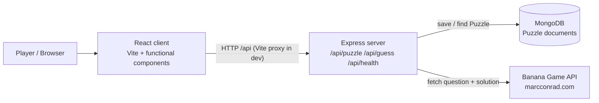

# Banana Quiz architecture

Portions of this file were generated with AI assistance (Cursor) and reviewed by the author.

## Component diagram

The React app never talks to the Banana API or to MongoDB. Only `client/src/api/puzzleApi.js` calls the Express backend. Only `server/src/services/bananaApi.js` calls the external Banana API.

## Data flow: get puzzle

1. The player clicks **Start Game** or **Next Puzzle**.
2. `App.jsx` calls `fetchPuzzle()` in `puzzleApi.js`, which sends `GET /api/puzzle`.
3. The Express controller calls `fetchPuzzleFromBananaApi()`.
4. That service requests `BANANA_API_URL` (HTTPS JSON). The observed fields are `question` (image URL) and `solution` (number).
5. Express saves a `Puzzle` document `{ imageUrl, solution, solved: false, createdAt }` in MongoDB.
6. Express responds with `{ puzzleId, imageUrl }` only. `solution` is not included.
7. React stores that object in `puzzle` state and shows the image.

## Data flow: submit guess

1. The player types a whole number and submits the form (`onSubmit` + `preventDefault`).
2. `submitGuess()` sends `POST /api/guess` with `{ puzzleId, guess }`.
3. Express checks that `puzzleId` is a Mongo ObjectId and that `guess` is a JSON integer (not a string, decimal, empty, or NaN).
4. Express loads the Puzzle. Missing or TTL-expired documents return 404.
5. If `solved` is already true, Express returns 409.
6. The guess is compared to the stored `solution`. A correct guess sets `solved = true`.
7. Express responds with `{ correct: true }` or `{ correct: false }`. The solution is never returned.
8. React shows **Correct!** or **Wrong, try again**. After a correct answer the form is hidden and **Next Puzzle** is shown.

## Why the solution stays on the server

The Banana API includes the answer in the same payload as the image. If that payload reached the browser, a player could read the solution in the Network tab. Storing `solution` only in MongoDB, and returning `{ puzzleId, imageUrl }` / `{ correct }`, means the client can play honestly. The Puzzle TTL (1 hour) also drops unused answers automatically.

## Future authentication (not built)

The Puzzle schema has a comment marking where a `userId` reference would go. An auth middleware could later sit in front of the puzzle routes without changing the current request/response shape.
